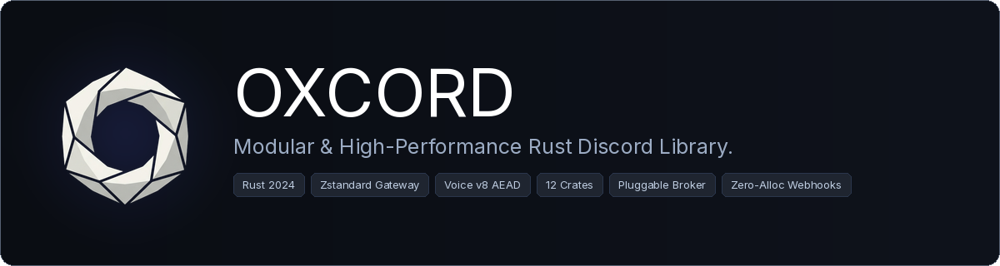

<p align="center">
  
</p>

# oxcord-broker

<p align="center">
  <a href="https://crates.io/crates/oxcord-broker"></a>
  <a href="https://docs.rs/oxcord-broker"></a>
  <a href="../../LICENSE"></a>
  <a href="https://www.rust-lang.org"></a>
  <a href="https://discord.com/developers/docs"></a>
</p>

<p align="center">
  <a href="../../README.md"><b>Workspace Root</b></a> •
  <a href="https://oxcord.noxlydev.xyz"><b>Documentation</b></a> •
  <a href="../../examples/"><b>Examples</b></a> •
  <a href="https://discord.gg/JnTRems5CT"><b>Discord Community</b></a>
</p>

**Distributed Message Broker & RPC** — Pluggable message broker abstraction supporting InProcess, Redis, NATS, and Kafka for million-guild scale.

Part of the [**OXCORD**](../../README.md) multi-crate ecosystem.

---

## Features

- **`Broker` trait**: Unified async publish/subscribe and RPC (request-reply) interface.
- **`InProcessBroker`**: Zero-dependency broadcast broker using Tokio channels for single-process architectures.
- **`RedisBroker`** (feature `redis`): Redis Pub/Sub backend for containerized deployments.
- **`NatsBroker`** (feature `nats`): Ultra-low-latency pure Rust NATS backend.
- **`KafkaBroker`** (feature `kafka`): 100% pure Rust Kafka backend (`rskafka`) for high-throughput enterprise event streaming.
- **`RpcDispatcher`**: Cross-shard request-response dispatching across microservices.

## Usage

```toml
[dependencies]
oxcord-broker = { version = "0.1.0", features = ["nats"] } # or "redis", "kafka"
```


---

## License

Licensed under the Apache License, Version 2.0 ([LICENSE](../../LICENSE)).
